<h1 align="center">Hey  soy Juan · Sigilock</h1>

## 📌 About Me
- 💡 <em>Construyo herramientas con IA que sí funcionan: IA, automatización y ciberseguridad.</em>
- 🛠️ Creé **[Meat Signal](https://meatsignal.com)** solo: señales de compra de carne para compradores B2B (~80 % de acierto en COMPRAR, prueba fuera de muestra 2022–2026).
- 🤖 Automatizo procesos para pymes: bots, dashboards y apps a medida.
- 🔐 Noticias de IA y ciberseguridad en menos de 60 segundos en **[@sigilock](https://instagram.com/sigilock)**.

## 📊 GitHub Stats & Trophies

  
  

  

  

  

## 🛠️ Languages & Tools

> ## Programming Languages

      

> ## Frontend

     

> ## Backend

  

> ## Database

   

> ## DevOps & Cloud

   

> ## Seguridad

  

> ## Tools

    

## 🔗 Connect with Me

   

Juan · <a href="https://www.gitskins.com/readme-generator?template=community-creative-dev-rt3x">creative dev</a> template by <a href="https://www.gitskins.com/creators/himanshu201031">@himanshu201031</a> · generated with <a href="https://www.gitskins.com/readme-generator">GitSkins</a>

